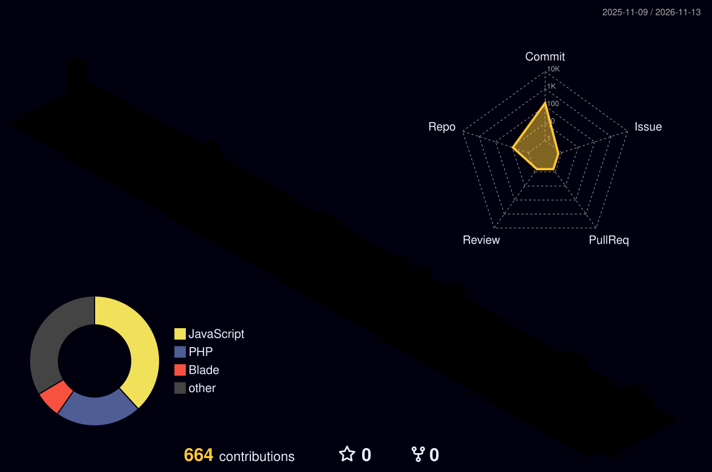

✦ About Me
I'm Alaa Eldin Mohammed Al-Dohdar, a Computer Systems Engineering graduate and Full-Stack Developer based in Gaza, Palestine. I have 2+ years of hands-on experience building production-oriented applications, with a strong focus on Laravel backend engineering, RESTful APIs, database design, RBAC, and multi-tenant SaaS systems.
- 💼 Backend Developer (Part-Time) at HOSKADEV.
- 🚀 Backend developer on WorkFlow, a project and team management SaaS platform.
- 🤖 Building practical AI features: AI Data Import, Project Health Analysis, Meeting Summaries, and Claude MCP integration.
- 🛡️ Interested in secure API design, maintainable architecture, testing, and reliable deployment.
- 🌍 Open to remote backend and full-stack engineering opportunities.
⚡ Technical Arsenal

Languages & Frontend

Backend, Data & Tools

AI & Automation

🚀 Selected Projects
🌌 WorkFlow — Project & Team Management SaaS
Backend Development · Laravel · MySQL · REST APIs · RBAC · AI APIs · MCP

A multi-tenant platform for projects, tasks, employees, clients, meetings, and financial operations.
- Developed backend APIs, authentication, authorization, and role-based access controls.
- Contributed to invoicing, payments, wallets, multi-currency workflows, and dashboards.
- Built AI Data Import and AI Project Health Analysis features.
- Developed meeting functionality and AI Meeting Summaries.
- Integrated Claude via Model Context Protocol (MCP).
🏥 Clinic Management System
Laravel · MySQL · Bootstrap — Appointment scheduling and clinic administration workflows with a responsive interface.
📋 Project Management System
Laravel · React · MySQL — Internal project tracking, task assignment, and team collaboration. Live system; login required.
🔐 Healthcare Backend API & Audit System
Laravel · MySQL · REST APIs · RBAC — Secure administrative API with role-based access, authentication event logging, and audit trails.
💼 Experience
Role	Organization	Period
Backend Developer · Part-Time	HOSKADEV	Nov 2025 – Present
Backend API Developer · Contract	ePluribus Health	May 2026
Web Development Intern	HOSKADEV	Apr 2025 – Oct 2025

📊 GitHub Pulse

🐍 Contribution Snake

<picture>
  <source media="(prefers-color-scheme: dark)" srcset="https://raw.githubusercontent.com/AlaaMhammad/AlaaMhammad/output/github-contribution-grid-snake-dark.svg" />
  
</picture>
🧊 3D Contribution Calendar

🎓 Education & Training
B.Eng. Computer Systems Engineering — Al-Azhar University, Gaza (2021–2026) · GPA: 87%
- AI & AI Automation — UNDP, An-Najah National University & WAC
- Front-End Web Development (React JS) — SEF Future
- Full-Stack Web Development Internship (320 hours) — HOSKADEV
- AI Certified Freelancer — Taqat Work Platform

✦ Let's Build Something Meaningful
Secure APIs · Scalable SaaS · AI-Powered Workflows

