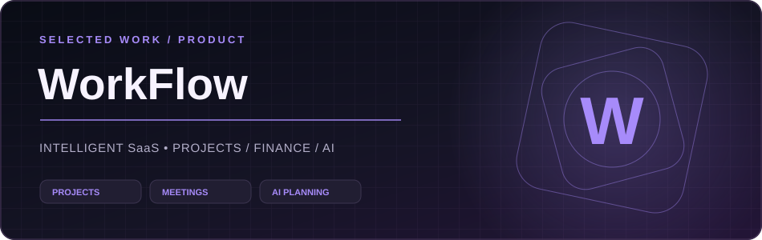
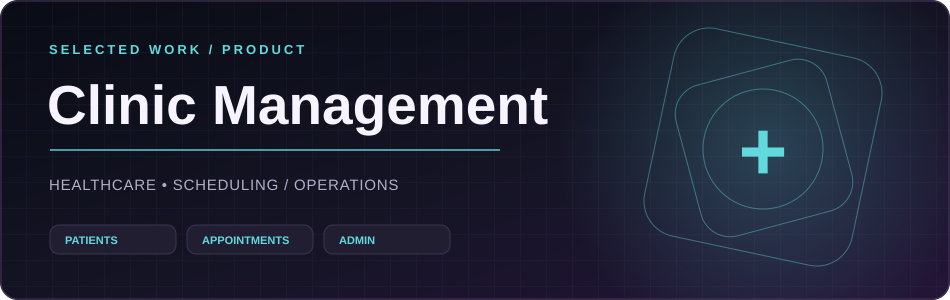
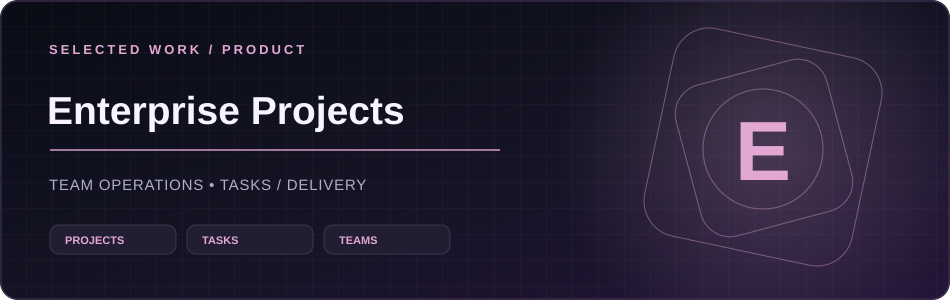

 

 

###  Engineering software that makes an impact

I'm **Alaa Eldin Mohammed Al-Dohdar**, a **Computer Systems Engineering graduate** and **Full-Stack Developer**, with **2+ years of experience** building real-world software. My specialty is **Laravel backend engineering**: REST APIs, secure authentication, database design, RBAC, and multi-tenant SaaS systems.

**Currently:** Backend Developer at **HOSKADEV** · Gaza, Palestine · Open to remote opportunities.

### ⚡ Technology stack

| Backend & databases | Frontend |
|:--:|:--:|
|  |  |
| **Developer tools** | **AI & automation** |
|  |    |

### ✦ Selected projects

<!-- Branded project covers. Live project links are provided; covers are not screenshots. -->

**[WorkFlow](https://www.workflownets.com/) — AI-Powered Project & Team Management SaaS** · *Backend Developer & Team Leader*

Multi-tenant platform for projects, tasks, employees, meetings, clients, and financial operations. Backend contributions include **secure REST APIs**, **AI Data Import**, **AI Project Health**, **AI Meeting Summaries**, and **Claude MCP integration**.

Laravel · PHP · MySQL · RBAC · REST APIs · AI · MCP &nbsp; · &nbsp; **[Explore WorkFlow ↗](https://www.workflownets.com/)**

<table>
<tr>
<td width="50%" valign="top">

**[Clinic Management System](https://labbaass.com/)**

Healthcare scheduling, clinic administration, and responsive operational workflows.

Laravel · MySQL · Bootstrap

</td>
<td width="50%" valign="top">

**[Enterprise Project Management](https://managment.hoskadev.com/)**

Internal platform for project tracking, task assignments, and team collaboration.

Laravel · React · MySQL

</td>
</tr>
</table>

<strong>💼 Professional experience, more work & education</strong>

- **Backend Developer · HOSKADEV** — Nov 2025–Present: Laravel systems, APIs, database design, deployments, and production support.
- **Backend API Developer · ePluribus Health** — May 2026: secure Laravel APIs, RBAC, and audit logging.
- **Web Development Intern · HOSKADEV** — Apr–Oct 2025: 320 hours of Laravel and React development.
- **Healthcare Backend API & Audit System** — secure administration APIs and activity logging.
- **B.Eng. in Computer Systems Engineering** — Al-Azhar University, Gaza (2026).

### 📊 Developer activity

 

### 🐍 Contribution animation

<picture>
  <source media="(prefers-color-scheme: dark)" srcset="https://raw.githubusercontent.com/AlaaMhammad/AlaaMhammad/output/github-contribution-grid-snake-dark.svg"/>
  
</picture>

<strong>🌌 Explore my 3D contribution calendar</strong>

 

---

<strong>Building dependable systems. Solving real problems.</strong> <a href="mailto:alaamhammad2003@gmail.com">Email</a> · <a href="https://www.linkedin.com/in/alaa2003">LinkedIn</a> · <a href="https://www.workflownets.com/">WorkFlow</a>

